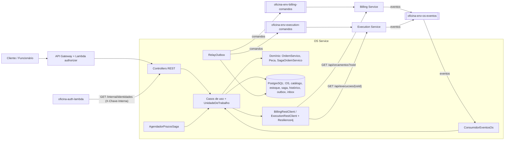

# tech-challenge-1 — OS Service

Serviço de ordens de serviço da oficina mecânica, desenvolvido no Tech Challenge da PosTech FIAP (Arquitetura de Software). Na Fase 4 o monólito das fases anteriores foi dividido em três serviços; este repositório mantém clientes, veículos, funcionários, catálogo de serviços e peças, estoque e ordens de serviço, e orquestra a saga que coordena o Billing Service (orçamento e pagamento) e o Execution Service (diagnóstico e reparo).

[](https://sonarcloud.io/summary/new_code?id=Guilherme-Fumagali_tech-challenge-1)
[](https://sonarcloud.io/summary/new_code?id=Guilherme-Fumagali_tech-challenge-1)
[](https://sonarcloud.io/summary/new_code?id=Guilherme-Fumagali_tech-challenge-1)

## Repositórios do projeto

| Repositório | Conteúdo |
|---|---|
| [tech-challenge-1](https://github.com/Guilherme-Fumagali/tech-challenge-1) | OS Service e orquestrador da saga (este repositório) |
| [oficina-billing-service](https://github.com/Guilherme-Fumagali/oficina-billing-service) | Orçamento, aprovação, pagamento no Mercado Pago e estorno |
| [oficina-execution-service](https://github.com/Guilherme-Fumagali/oficina-execution-service) | Fila de execução, diagnóstico e reparo |
| [oficina-auth-lambda](https://github.com/Guilherme-Fumagali/oficina-auth-lambda) | Autenticação por CPF com segundo fator e authorizer JWT |
| [oficina-infra-k8s](https://github.com/Guilherme-Fumagali/oficina-infra-k8s) | Rede, EKS, API Gateway, ECR e New Relic (Terraform) |
| [oficina-infra-db](https://github.com/Guilherme-Fumagali/oficina-infra-db) | RDS da Fase 3; na Fase 4 o banco do OS Service passou para `infra/` deste repositório |

## Links

| Artefato | Local |
|---|---|
| Contrato OpenAPI | [`docs/openapi.json`](docs/openapi.json), no [Redoc](https://redocly.github.io/redoc/?url=https://raw.githubusercontent.com/Guilherme-Fumagali/tech-challenge-1/develop/docs/openapi.json) e no [Swagger Editor](https://editor.swagger.io/?url=https://raw.githubusercontent.com/Guilherme-Fumagali/tech-challenge-1/develop/docs/openapi.json) |
| Contrato das mensagens | [`docs/asyncapi.yaml`](docs/asyncapi.yaml) (AsyncAPI 2.6), no [AsyncAPI Studio](https://studio.asyncapi.com/?url=https://raw.githubusercontent.com/Guilherme-Fumagali/tech-challenge-1/develop/docs/asyncapi.yaml) |
| Swagger UI | `http://localhost:8080/swagger-ui.html` na execução local |
| Requisições de demonstração | [`docs/demo.http`](docs/demo.http): fluxo completo pelos três serviços via API Gateway, com login em duas etapas |
| Carga de dados de demonstração | [`scripts/preparar-demo.sh`](scripts/preparar-demo.sh): autentica o funcionário em duas etapas (pede o código no terminal), cadastra cliente, veículo e catálogo e abre ordens de serviço. Uso: `CPF_FUNCIONARIO=... ./scripts/preparar-demo.sh` (requer `curl`, `jq` e credenciais AWS para ler a URL do SSM, ou `API_URL`) |
| Testes | [`docs/testes.md`](docs/testes.md) |
| Runbooks dos alertas | [`docs/runbooks`](docs/runbooks) |
| Documentação da Fase 4: ADRs 016 a 023, diagramas, Domain Storytelling, débitos técnicos, relatório e slides | [`docs/tech-challenge-4`](docs/tech-challenge-4/README.md) |
| Documentação das fases anteriores | [`docs/tech-challenge-3`](docs/tech-challenge-3), [`docs/tech-challenge-2`](docs/tech-challenge-2), [`docs/tech-challenge-1`](docs/tech-challenge-1) |
| Vídeo de demonstração | a publicar |

## Arquitetura

O OS Service roda no EKS, atrás do API Gateway (VPC Link, NLB e NodePort 30080). O gateway valida o JWT com o Lambda authorizer; o serviço valida o token de novo, persiste no RDS PostgreSQL próprio (`oficina-os-db-<env>`) e conversa com os outros dois serviços por filas SQS. A única chamada síncrona entre serviços é a composição do acompanhamento da OS.



Internamente, o código segue Clean Architecture:

```
src/main/java/com/oficina/mecanica/
├── domain/          entidades, value objects, máquina de estados da saga (domain/saga), exceções e portas de repositório, sem framework
├── application/     casos de uso, porta UnidadeDeTrabalho e portas de mensageria, métricas e consulta aos participantes
└── infrastructure/  Spring Boot, JPA, REST, segurança, mensageria SQS (outbox, relay, inbox, consumidor), clientes REST e métricas
```

Cada caso de uso que grava dados roda em uma única transação (porta `UnidadeDeTrabalho`), incluindo o histórico e as mensagens do outbox. `ordens_servico` e `pecas` têm trava otimista (`@Version`): uma gravação com versão desatualizada responde 409.

## Papel na saga

O OS Service é o orquestrador da saga da ordem de serviço. A orquestração foi escolhida porque o fluxo envolve três serviços e quatro caminhos de compensação: com um orquestrador, o estado de cada saga fica em um só lugar (`sagas_ordem_servico` e `saga_passos`), pode ser consultado em `GET /api/ordens/{id}/saga` e é retomado após reinício de pod. A justificativa completa está na [ADR-017](docs/tech-challenge-4/adrs/ADR-017-saga-orquestrada.md).

A lógica de transição fica na classe de domínio `SagaOrdemServico`, sem Spring: recebe o evento e devolve a decisão (ação na OS, comandos a enviar e compensação local). Os estados estão no [diagrama da saga](docs/tech-challenge-4/diagramas/estados-saga.md).

Compensações, na ordem da visão pessimista (aula 3 de SAGA): primeiro o que impede trabalho novo, por último o que devolve recurso:

| Motivo | Gatilho | Ordem |
|---|---|---|
| `REPROVACAO` | `OrcamentoReprovado` ou `OrcamentoExpirado` | `CancelarExecucao` → estorno do estoque |
| `REJEICAO` | `ComandoRejeitado` para `GerarOrcamento` | `CancelarExecucao` → estorno do estoque |
| `PAGAMENTO_RECUSADO` | `PagamentoRecusado` | `CancelarOrcamento` → `CancelarExecucao` → estorno do estoque |
| `FALHA_EXECUCAO` | `ExecucaoFalhou` | `EstornarPagamento` → `CancelarOrcamento` → estorno do estoque |

O estorno do estoque é a compensação local: devolve as peças de cada item à `Peca` correspondente, cancela a OS e só ocorre se a OS ainda não estiver `CANCELADA`.

Depois do pagamento aprovado, desfazer a saga exige estorno no Mercado Pago. Por isso só a falha na execução estorna o pagamento. Falha técnica (serviço fora do ar, erro de rede) não gera compensação: a mensagem volta para a fila e é repetida.

Se um participante não responde no prazo (2 minutos), o comando é reenviado; depois de 3 reenvios a saga vai para `FALHA` e gera alerta ([runbook](docs/runbooks/saga-falha.md)). Um evento que chega fora de ordem volta para a fila e é reprocessado.

## Mensagens

O contrato está em [`docs/asyncapi.yaml`](docs/asyncapi.yaml).

| Direção | Fila | Tipos |
|---|---|---|
| Publica | `oficina-<env>-execution-comandos` | `IniciarDiagnostico`, `ReabrirDiagnostico`, `IniciarReparo`, `CancelarExecucao` |
| Publica | `oficina-<env>-billing-comandos` | `GerarOrcamento`, `CancelarOrcamento`, `EstornarPagamento` |
| Consome | `oficina-<env>-os-eventos` | `ExecucaoEnfileirada`, `DiagnosticoIniciado`, `DiagnosticoConcluido`, `ReparoIniciado`, `ExecucaoFinalizada`, `ExecucaoFalhou`, `ExecucaoCancelada`, `OrcamentoGerado`, `OrcamentoAprovado`, `OrcamentoReprovado`, `OrcamentoExpirado`, `OrcamentoCancelado`, `PagamentoAprovado`, `PagamentoRecusado`, `PagamentoEstornado`, `ComandoRejeitado` |

Toda mensagem é um envelope JSON com `mensagemId`, `tipo`, `versao`, `sagaId`, `osId`, `causadaPor`, `origem`, `ocorridoEm` e `dados`.

As mensagens são gravadas na tabela `outbox` na mesma transação do caso de uso e enviadas para a fila pelo `RelayOutbox` (Transaction Outbox). O consumidor registra o `mensagemId` em `mensagens_processadas` na mesma transação do efeito, e uma mensagem repetida é ignorada (handler idempotente). Uma mensagem que falha cinco vezes vai para a DLQ `oficina-<env>-os-eventos-dlq`, que gera alerta.

## Banco e justificativa

PostgreSQL 16 em RDS (`oficina-os-db-<env>`, banco `oficina`, `db.t4g.micro`, `rds.force_ssl=1`), provisionado pelo Terraform de [`infra/`](infra) e acessível apenas pelo security group dos nós do EKS. Na Fase 3 a mesma instância era lida também pela função de autenticação; na Fase 4 a função consulta o endpoint interno `/internal/identidades` e nenhum outro serviço tem credencial deste banco.

Motivos da escolha:

- Entidades relacionadas com regras garantidas pelo banco: estoque não negativo, CPF/CNPJ e placa únicos, chaves estrangeiras entre OS, itens, peças e serviços.
- A reserva de estoque e o item da OS são gravados na mesma transação; o outbox só é confiável se a mudança de estado e a mensagem estiverem no mesmo banco.
- O relatório de tempo médio e a listagem por prioridade são consultas relacionais.

Um banco NoSQL perderia as constraints e a transação entre tabelas. O Billing usa outra instância PostgreSQL e o Execution usa DocumentDB; a justificativa de cada um está na [ADR-019](docs/tech-challenge-4/adrs/ADR-019-banco-por-servico.md).

| Migration | Conteúdo |
|---|---|
| V1 a V9 | esquema das fases 1 a 3 e funcionário de homologação |
| V10 | coluna `versao` em `ordens_servico` e `pecas` |
| V11 | status `AGUARDANDO_PAGAMENTO`; remoção do token de aprovação externa |
| V12 | `sagas_ordem_servico` e `saga_passos` |
| V13 | `historico_status_os` |
| V14 | `outbox` e `mensagens_processadas` |
| V15 (Java) | e-mail do funcionário de homologação a partir de `FUNCIONARIO_SEED_EMAIL` |
| V16 | remoção de `refresh_tokens` (DT-07) |

## Tecnologias

| Área | Tecnologia |
|---|---|
| Linguagem e framework | Java 21, Spring Boot 3.4 |
| Persistência | PostgreSQL 16, Spring Data JPA, Flyway, MapStruct |
| Mensageria | Amazon SQS, Spring Cloud AWS 3.3.1 (AWS SDK v2) |
| Resiliência | Resilience4j 2.2.0 (TimeLimiter, CircuitBreaker e Bulkhead) |
| Segurança | Spring Security, JJWT 0.12 (validação de JWT HMAC), chave interna para `/internal/**` |
| Documentação | SpringDoc OpenAPI, AsyncAPI 2.6 |
| Observabilidade | agente Java do New Relic 9.4.0 com `newrelic-api`, Micrometer com OTLP, logs em formato ECS |
| Testes | JUnit 5, Mockito, AssertJ, Testcontainers (PostgreSQL e LocalStack), WireMock, Cucumber 7, JaCoCo |
| Build e implantação | Maven, Docker, GitHub Actions, Amazon ECR, Amazon EKS com Kustomize, Terraform |

## Execução local

Pré-requisitos: Docker e Docker Compose, com as portas `8080`, `5432` e `4566` livres.

```bash
cp .env.example .env
docker compose up --build
```

| Serviço | Endereço |
|---|---|
| API | `http://localhost:8080` |
| Swagger UI | `http://localhost:8080/swagger-ui.html` |
| LocalStack (SQS) | `http://localhost:4566`, filas `oficina-local-*` criadas por [`localstack/init/ready.d/criar-filas.sh`](localstack/init/ready.d/criar-filas.sh) |

O contêiner `api` sobe com o perfil `local`, que aponta o SQS para o LocalStack com credenciais estáticas. Billing e Execution podem rodar nas portas 8081 e 8082 da máquina; sem eles, a abertura da OS funciona, os comandos ficam nas filas e o acompanhamento informa as fontes indisponíveis.

Sem Docker para a aplicação, com PostgreSQL e LocalStack já em execução:

```bash
./mvnw spring-boot:run -Dspring-boot.run.profiles=local
```

### Variáveis de ambiente

| Variável | Padrão | Descrição |
|---|---|---|
| `DB_URL` | `jdbc:postgresql://localhost:5432/oficina` | URL do banco |
| `DB_USER` / `DB_PASS` | `oficina` | Credenciais do banco |
| `JWT_SECRET` | valor padrão só nos perfis `local` e `test` | Chave HMAC dos tokens; sem ela a aplicação não sobe nos demais perfis |
| `CHAVE_INTERNA` | `chave-interna-local` no perfil `local` | Valor esperado no cabeçalho `X-Chave-Interna` das rotas `/internal/**` |
| `FILA_OS_EVENTOS` | `oficina-local-os-eventos` | Fila consumida |
| `FILA_BILLING_COMANDOS` | `oficina-local-billing-comandos` | Fila de comandos do Billing |
| `FILA_EXECUTION_COMANDOS` | `oficina-local-execution-comandos` | Fila de comandos do Execution |
| `FILA_DLQ` | `<fila de eventos>-dlq` | DLQ medida pelo gauge |
| `AWS_REGION` | `us-east-1` | Região do SQS |
| `SQS_ENDPOINT` | `http://localhost:4566` no perfil `local` | Endpoint do LocalStack |
| `BILLING_URL` / `EXECUTION_URL` | `http://localhost:8081` / `http://localhost:8082` | Participantes consultados no acompanhamento |
| `FUNCIONARIO_SEED_CPF`, `FUNCIONARIO_SEED_NOME`, `FUNCIONARIO_SEED_EMAIL` | — | Funcionário cadastrado pelas migrations V9 e V15; definidos apenas em homologação |
| `ENV` | `local` | Atributo `env` das métricas |
| `SPRING_PROFILES_ACTIVE` | — | `local` para o compose; `k8s` ativa o log estruturado em JSON |
| `NEW_RELIC_APP_NAME`, `NEW_RELIC_LICENSE_KEY` | vazio (agente desligado) | Agente de APM |
| `OTEL_EXPORTER_OTLP_METRICS_ENDPOINT` | `http://localhost:4318/v1/metrics` | Destino das métricas de negócio |

## Implantação

Os ambientes seguem a [ADR-012](docs/tech-challenge-3/adrs/ADR-012-ambientes-segregados.md):

| Branch | Ambiente | Aprovação |
|---|---|---|
| `develop` | homologação (`staging`) | não |
| `main` | produção (`prod`) | sim, no GitHub Environment `prod` |

| Pasta | Conteúdo |
|---|---|
| [`infra/`](infra) | Terraform do serviço: RDS `oficina-os-db-<env>` (migrado do `oficina-infra-db`, sem a regra de entrada da função de autenticação), filas `oficina-<env>-os-eventos` e `-dlq` (SSE-SQS, `maxReceiveCount` 5), role de pod `oficina-os-pod-<env>` com o boundary `oficina-pod-boundary` e associação Pod Identity ao ServiceAccount `os-service`, e os parâmetros `/oficina/<env>/os/db-*` no SSM. State em `os/<env>/terraform.tfstate` |
| [`k8s/`](k8s) | Kustomize: Deployment, Service NodePort 30080, HPA (CPU 70%, 2 a 3 réplicas), PDB, ServiceAccount e ConfigMap na base; overlays `staging` e `prod` com nomes de fila e de aplicação do ambiente |

O Deployment roda com usuário 1001, sistema de arquivos somente leitura (com `emptyDir` em `/tmp`), sem escalonamento de privilégio e sem capabilities; as sondas usam `/actuator/health/liveness` e `/actuator/health/readiness`, e o encerramento é gracioso (`server.shutdown=graceful`). A aplicação recebe credenciais AWS pela Pod Identity, sem chave estática.

Ordem de provisionamento: plataforma (`oficina-infra-k8s` base e cluster) → `infra/` dos três serviços → função de autenticação → segunda passada da plataforma → pipelines dos serviços. A destruição segue a ordem inversa.

## CI/CD

| Workflow | Job | Quando executa | O que faz |
|---|---|---|---|
| [`ci-cd.yml`](.github/workflows/ci-cd.yml) | Build & Test | todo push | `./mvnw -B verify`: unitários, integração com Testcontainers, cenários BDD, contrato OpenAPI e limites de cobertura; publica os relatórios JaCoCo e Cucumber e o resumo de cobertura |
| | SonarCloud | todo push; analisa a branch como pull request quando há PR aberto, e a `main` | análise estática e cobertura, aguardando o quality gate |
| | Build & push no ECR | push em `develop` ou `main`, com os dois jobs anteriores aprovados | imagem com as tags do commit e `latest` no repositório lido de `/oficina/<env>/os/ecr-repository-url`; sem repositório, conclui com aviso |
| | Conferir cluster | após a publicação da imagem | verifica se o cluster do ambiente existe |
| | Deploy no EKS | cluster existente | cria o Secret `os-service-secrets` a partir do SSM, aplica o overlay com a imagem do commit, aguarda o rollout e consulta `/actuator/health/readiness` e `/actuator/info` |
| [`infra.yml`](.github/workflows/infra.yml) | Format & validate (infra) | todo push | `terraform fmt`, `validate`, tflint e checkov |
| | Plan / Apply | disparo manual em `develop` ou `main` | plan, e apply no GitHub Environment do ambiente |
| [`destroy-aws.yml`](.github/workflows/destroy-aws.yml) | Destroy | disparo manual | `terraform destroy` e conferência de que banco, filas e role foram removidos |

- Os testes rodam em todo push; a análise do SonarCloud roda no pull request e na `main`; o deploy só ocorre depois de **Build & Test** e **SonarCloud** aprovados.
- As branches `develop` e `main` não aceitam push direto: o merge exige pull request com uma aprovação e as verificações **Build & Test**, **SonarCloud** e **Format & validate (infra)**.
- A autenticação na AWS usa OIDC com a role `oficina-api-github-actions`, sem chave estática ([ADR-013](docs/tech-challenge-3/adrs/ADR-013-identidade-das-pipelines.md)). Os segredos da aplicação são lidos do SSM no momento do deploy; os dados do funcionário de homologação vêm de segredos do repositório e só são usados em `staging`.
- O deploy em produção aguarda a revisão obrigatória do GitHub Environment `prod`.

## Testes

| Tipo | Classes | Casos |
|---|---|---|
| Domínio (Java puro) | 7 | 129 |
| Aplicação (Mockito) | 13 | 99 |
| Infraestrutura, unitários | 11 | 54 |
| Integração (Spring, PostgreSQL e LocalStack via Testcontainers, WireMock) | 8 | 44 |
| BDD (Cucumber, Gherkin em português) | 1 funcionalidade | 7 cenários |
| **Total** | | **333** |

A tabela de transições da saga tem um teste por linha em `SagaOrdemServicoTest`. Os cenários BDD cobrem o fluxo completo até a entrega, a reprovação, o pagamento recusado, a falha na execução com estorno, o diagnóstico sem itens, a mensagem duplicada e o reenvio por prazo vencido. A descrição por classe está em [`docs/testes.md`](docs/testes.md).

```bash
./mvnw test      # requer Docker para o Testcontainers
./mvnw verify    # inclui os relatórios em target/site/jacoco/index.html e target/cucumber/relatorio.html
```

### Evidência de cobertura

Execução de `./mvnw -B verify` em 30/10/2026 (JaCoCo 0.8.12):

| Pacotes | Linhas | Cobertura de linhas | Ramos | Cobertura de ramos |
|---|---|---|---|---|
| `domain` | 523 | 99,8% | 199 | 92,5% |
| `application` | 416 | 100,0% | 62 | 95,2% |
| `infrastructure` | 1.104 | 91,8% | 225 | 77,8% |
| `db.migration` (migrations Java) | 26 | 84,6% | 12 | 50,0% |
| `OficinaMecanicaApplication` | 3 | 33,3% | 0 | — |
| **Total** | **2.072** | **95,3%** | **498** | **85,1%** |

O build falha abaixo de 85% de linhas e 70% de ramos no projeto ou de 80% de instruções nos pacotes de domínio. No CI, o relatório completo é publicado como artefato `jacoco-report` e o resumo de linhas e ramos aparece no sumário da execução; o SonarCloud recebe o `jacoco.xml` (badge de cobertura no topo deste documento).

## Autenticação e papéis

A aplicação não emite tokens. A função `oficina-auth-lambda` autentica pelo CPF em duas etapas: a primeira rota envia um código de seis dígitos ao e-mail cadastrado e devolve um desafio; a segunda troca o desafio e o código pelo JWT.

| Rota (API Gateway) | Identidade consultada no OS Service | Papel no token |
|---|---|---|
| `POST /auth` e `POST /auth/confirmacao` | `GET /internal/identidades/clientes/{cpfCnpj}` | `CLIENTE` |
| `POST /auth/funcionarios` e `POST /auth/funcionarios/confirmacao` | `GET /internal/identidades/funcionarios/{cpf}` | `FUNCIONARIO` |

As rotas `/internal/**` não têm rota no API Gateway; a função chega a elas pelo NLB e envia o cabeçalho `X-Chave-Interna`, verificado pelo `ChaveInternaFilter`. Sem chave ou com chave diferente, a resposta é 401 genérico; documento inexistente responde 404 sem repetir o documento.

| Papel | Acesso |
|---|---|
| `FUNCIONARIO` | todas as rotas `/api/**`: clientes, veículos, catálogo, estoque, ordens de serviço, saga e relatório |
| `CLIENTE` | leitura das próprias ordens (`GET /api/ordens`, `/{id}`, `/{id}/historico`, `/{id}/acompanhamento`) e dos próprios veículos; recurso de outro cliente retorna `404` |

O token é validado pelo Lambda authorizer e pelo `JwtService`: emissor `oficina-auth`, assinatura válida, dentro da validade e papel conhecido. Requisição sem token ou com token inválido recebe 401 em JSON (ProblemDetail); papel sem permissão recebe 403 em JSON.

## Endpoints

| Grupo | Rotas | Acesso |
|---|---|---|
| Clientes | `GET/POST/PUT/DELETE /api/clientes` | funcionário |
| Veículos | `POST/PUT/DELETE /api/veiculos`, `GET /api/veiculos/cliente/{clienteId}` | funcionário |
| Veículos (leitura) | `GET /api/veiculos`, `GET /api/veiculos/{id}` | funcionário; cliente, apenas os próprios |
| Serviços | `GET/POST/PUT/DELETE /api/servicos` | funcionário |
| Peças e estoque | `GET/POST/PUT/DELETE /api/pecas`, `POST /api/pecas/{id}/estoque/incrementar`, `GET /api/pecas/alerta-estoque` | funcionário |
| Abertura da OS | `POST /api/ordens` (201 com `id` e `sagaId`) | funcionário |
| Itens da OS | `POST /api/ordens/{id}/servicos`, `POST /api/ordens/{id}/pecas` (somente em `EM_DIAGNOSTICO`) | funcionário |
| Entrega | `POST /api/ordens/{id}/entregar` | funcionário |
| Consulta da OS | `GET /api/ordens`, `GET /api/ordens/{id}`, `GET /api/ordens/{id}/historico`, `GET /api/ordens/{id}/acompanhamento` | funcionário; cliente, apenas as próprias |
| Saga | `GET /api/ordens/{id}/saga` | funcionário |
| Relatório | `GET /api/ordens/relatorio/tempo-medio` | funcionário |
| Status público | `GET /api/ordens/{id}/status` (somente `id`, `status` e `atualizadoEm`) | pública |
| Identidades | `GET /internal/identidades/clientes/{cpfCnpj}`, `GET /internal/identidades/funcionarios/{cpf}` | cabeçalho `X-Chave-Interna` |
| Saúde e versão | `GET /actuator/health`, `/actuator/health/{liveness,readiness}`, `/actuator/info` (commit em execução) | pública |

As transições de status deixaram de ter endpoint: vêm dos eventos da saga. O acompanhamento compõe a OS e o histórico locais com o orçamento e o pagamento do Billing e a execução do Execution, consultados em paralelo com limite de 2 s e circuit breaker, repassando o `Authorization` recebido. Uma fonte indisponível vem nula e listada em `fontesIndisponiveis`.

## Observabilidade

| Sinal | Implementação |
|---|---|
| Métricas da OS | `oficina.os.abertas`, `oficina.os.transicoes`, `oficina.os.duracao_status` |
| Métricas da saga | `oficina.saga.iniciadas`, `oficina.saga.concluidas`, `oficina.saga.compensadas{motivo}`, `oficina.saga.falhas{estado}`, `oficina.saga.reenvios{comando}`, `oficina.saga.etapa.duracao{estado}` |
| Métricas de mensageria | `oficina.mensageria.publicadas{tipo}`, `oficina.mensageria.consumidas{tipo, resultado}`, `oficina.mensageria.dlq.mensagens{fila}` (lido da DLQ a cada 60 s) |
| Rastreamento pela fila | cabeçalhos do New Relic gravados no outbox, aceitos pelo relay e enviados como atributos da mensagem; o consumo aceita os cabeçalhos recebidos (`@Trace(dispatcher = true)`) |
| Correlação | atributos `os.id`, `saga.id` e `mensagem.tipo` nas transações de mensagem e MDC `os.id`, `saga.id` e `mensagem.id` nos logs ECS |
| Aplicação no New Relic | `oficina-os-service-<env>`, label `fase: tech-challenge-4` |

Dashboards e alertas são criados por Terraform no `oficina-infra-k8s`; cada alerta aponta para um procedimento em [`docs/runbooks`](docs/runbooks).

## Documentação

| Tema | Local |
|---|---|
| Contratos | [`docs/openapi.json`](docs/openapi.json), [`docs/asyncapi.yaml`](docs/asyncapi.yaml), [`docs/demo.http`](docs/demo.http) |
| Testes | [`docs/testes.md`](docs/testes.md) |
| Runbooks | [`docs/runbooks`](docs/runbooks) |
| Fase 4: ADRs 016 a 023, arquitetura geral, sequências e estados da saga, modelos de dados, débitos técnicos, relatório e slides | [`docs/tech-challenge-4`](docs/tech-challenge-4/README.md) |
| Domain Storytelling do fluxo distribuído (Fase 4) | [`docs/tech-challenge-4/diagramas/domain-storytelling.md`](docs/tech-challenge-4/diagramas/domain-storytelling.md) |
| DDD: Event Storming, Context Map, Domain Storytelling, linguagem ubíqua | [`docs/ddd`](docs/ddd) |
| Anti-Corruption Layer e notificação | [`docs/ddd/notificacao-acl.md`](docs/ddd/notificacao-acl.md) |
| Fase 3: RFCs, ADRs, diagramas, débitos técnicos, relatório e slides | [`docs/tech-challenge-3`](docs/tech-challenge-3) |
| Fases 1 e 2 | [`docs/tech-challenge-1`](docs/tech-challenge-1), [`docs/tech-challenge-2`](docs/tech-challenge-2) |

Vulnerabilidades em dependências são verificadas com OWASP Dependency-Check (`./mvnw dependency-check:check`, relatório em `target/dependency-check-report.html`). As supressões e a justificativa de cada CVE estão em `owasp-suppressions.xml`.

## Estrutura do repositório

```
├── src/main/java/com/oficina/mecanica/   domain (inclui domain/saga), application e infrastructure
├── src/main/resources/db/migration/      migrations Flyway em SQL (V1 a V8, V10 a V14, V16)
├── src/main/java/db/migration/           migrations Java de seed do funcionário de homologação (V9 e V15)
├── src/test/                             testes e cenários BDD (ver docs/testes.md)
├── infra/                                Terraform: RDS, filas, role de pod e parâmetros SSM do serviço
├── k8s/                                  Kustomize: base e overlays staging e prod
├── localstack/init/ready.d/              criação das filas no LocalStack
├── docs/                                 contratos, DDD, runbooks, testes e entregas por fase
├── scripts/                              carga de dados de demonstração
├── observability/                        Tempo e Grafana para execução local
├── .github/workflows/                    ci-cd.yml, infra.yml e destroy-aws.yml
├── Dockerfile                            build multi-stage com o agente New Relic
├── docker-compose.yml                    PostgreSQL, LocalStack e a API
└── pom.xml
```
