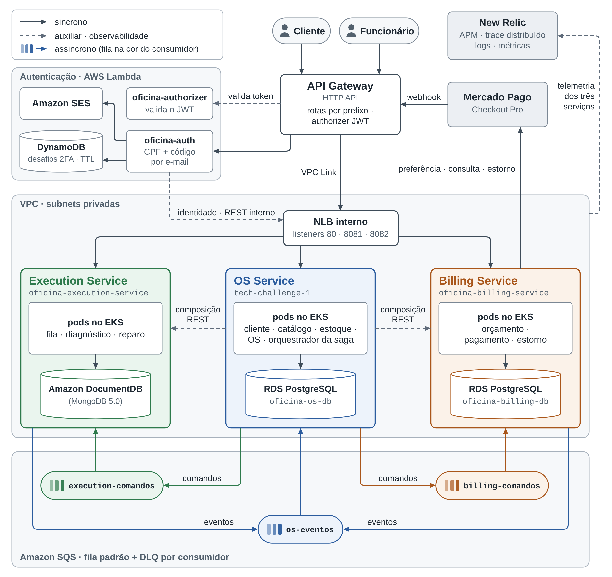

# Arquitetura geral — microsserviços, bancos e comunicação

Diagrama exigido no documento de entrega: os três microsserviços, o banco de cada um, a mensageria da saga, a borda e as integrações externas.

Versão vetorial: [`c2-arquitetura-geral.svg`](c2-arquitetura-geral.svg).

| Elemento | Responsabilidade | Persistência |
|---|---|---|
| OS Service | cadastro, catálogo e estoque, ordem de serviço, histórico, orquestração da saga | PostgreSQL próprio |
| Billing Service | orçamento, decisão do cliente, pagamento no Mercado Pago, estorno | PostgreSQL próprio |
| Execution Service | fila de execução, diagnóstico, reparo, falha | MongoDB (DocumentDB) próprio |
| Lambda de autenticação | login por CPF com segundo fator, emissão do JWT | DynamoDB próprio |
