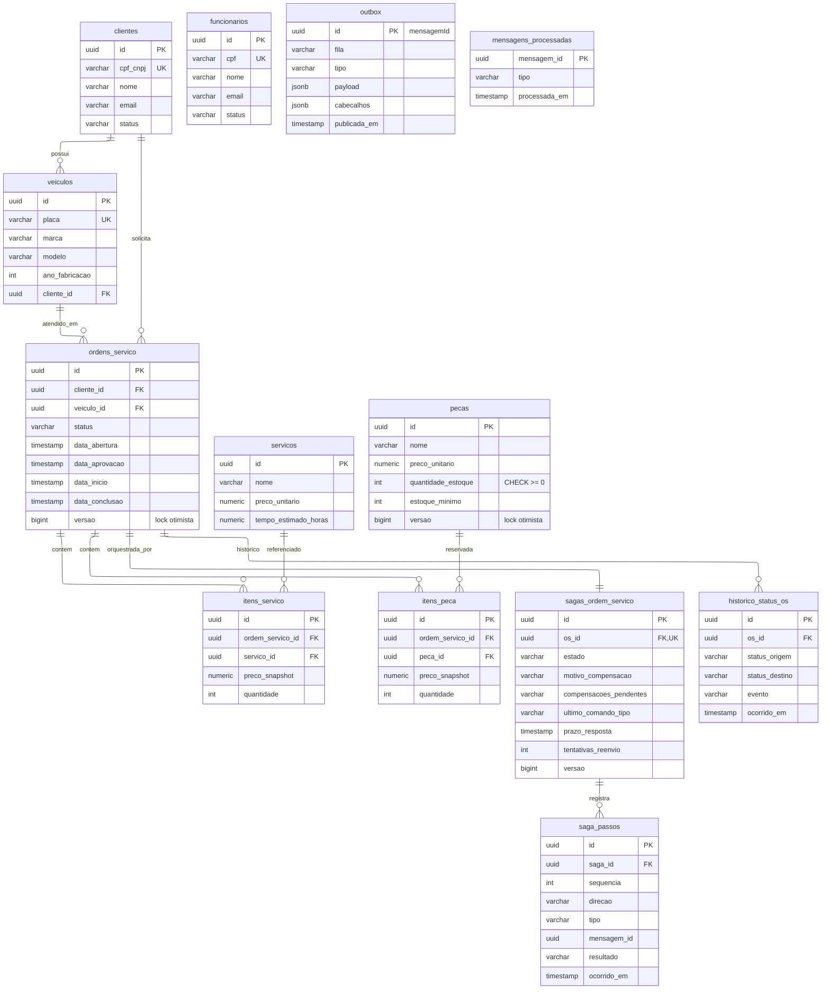

# DER — banco do OS Service (PostgreSQL)

Tabelas do domínio herdadas do monólito e tabelas novas da saga e da mensageria. As referências a cliente, veículo, serviço e peça continuam com chave estrangeira porque estão no mesmo serviço; nenhuma tabela referencia dado de outro serviço.

