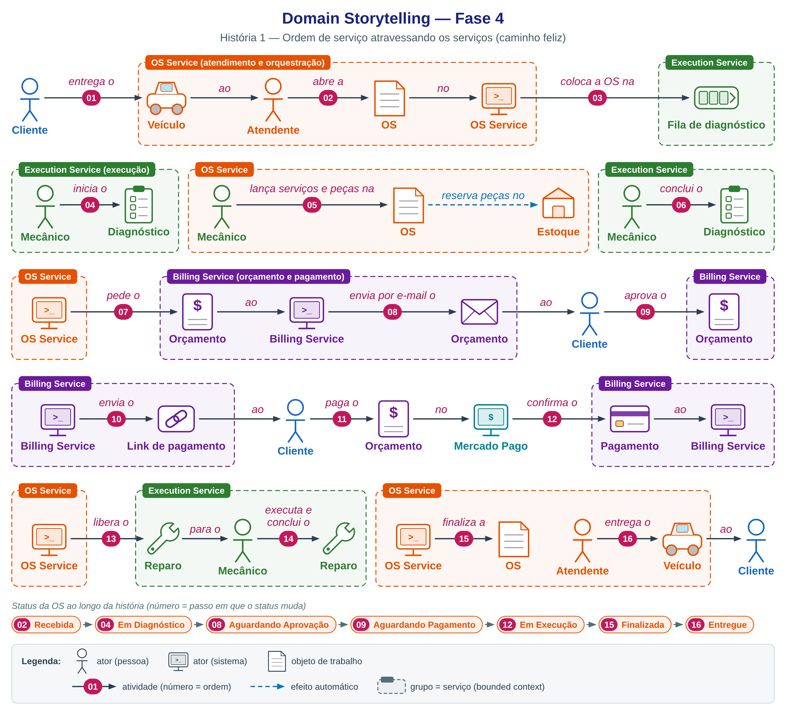
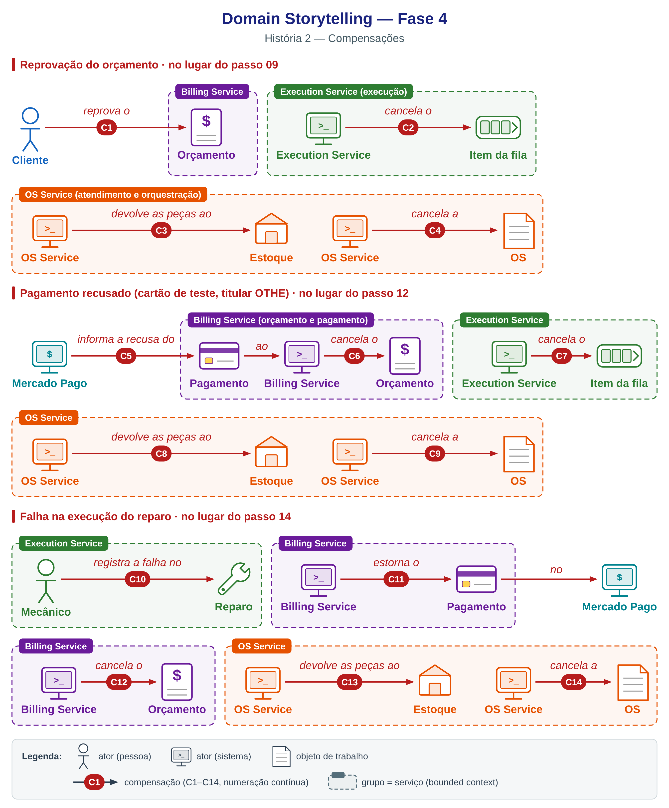

# Domain Storytelling — Fase 4

Narrativa do fluxo de uma ordem de serviço atravessando os três microsserviços, na notação de Domain Storytelling: atores (pessoas e sistemas), objetos de trabalho e atividades numeradas, agrupados pelo serviço (bounded context) em que acontecem. A Fase 1 tem o Domain Storytelling do monólito em [`../../ddd/domain_storytelling.svg`](../../ddd/domain_storytelling.svg).

## História 1 — ordem de serviço atravessando os serviços

Versão vetorial: [`domain-storytelling-fluxo.svg`](domain-storytelling-fluxo.svg).

## História 2 — compensações

Três desvios da história 1: reprovação do orçamento (passo 09), pagamento recusado (passo 12) e falha na execução (passo 14). A ordem das atividades segue a das compensações da saga.

Versão vetorial: [`domain-storytelling-compensacoes.svg`](domain-storytelling-compensacoes.svg).
