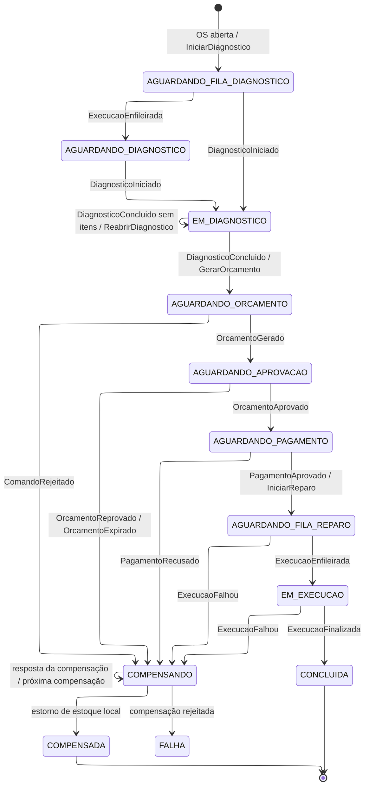

# Máquina de estados da saga

Estado persistido em `sagas_ordem_servico`. Estados com prazo de resposta têm reenvio automático do último comando (até 3 vezes) antes de irem para `FALHA`.

| Motivo | Compensações, em ordem |
|---|---|
| Reprovação ou expiração do orçamento | cancelar execução → estornar estoque |
| Comando rejeitado | cancelar execução → estornar estoque |
| Pagamento recusado | cancelar orçamento → cancelar execução → estornar estoque |
| Falha na execução | estornar pagamento → cancelar orçamento → estornar estoque |
