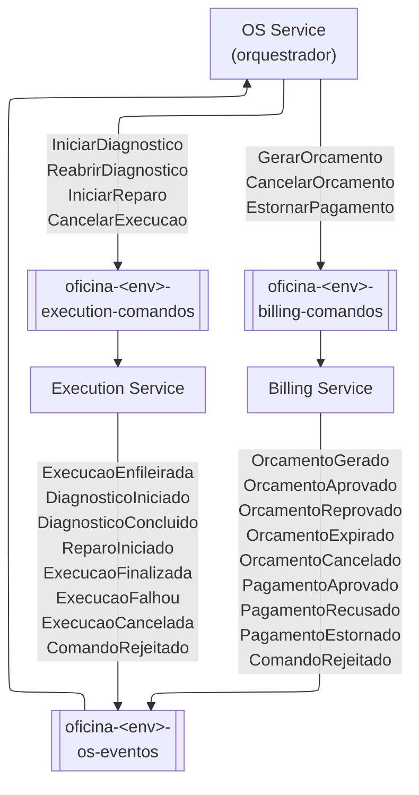

# Mapa de filas e mensagens

Cada fila pertence ao serviço que a consome e tem DLQ (`-dlq`, 5 recebimentos).

Envelope comum: `mensagemId`, `tipo`, `versao`, `sagaId`, `osId`, `causadaPor`, `origem`, `ocorridoEm`, `dados`.
