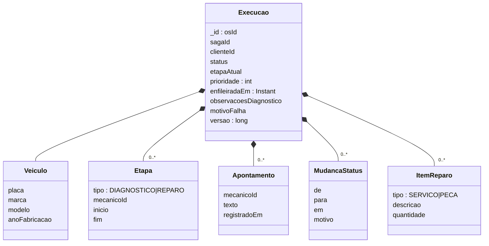

# Modelo de documento — Execution Service (MongoDB / DocumentDB)

Um documento por OS na coleção `execucoes` (`_id` = id da OS). Etapas, apontamentos e histórico ficam embutidos: o agregado é lido e gravado inteiro, e a atualização de um documento é atômica.

Índices criados na subida da aplicação:

| Coleção | Índice | Uso |
|---|---|---|
| `execucoes` | `{status: 1, prioridade: -1, enfileiradaEm: 1}` | fila por etapa |
| `execucoes` | `{clienteId: 1}` | visão do cliente |
| `outbox` | `{status: 1, criadaEm: 1}` | relay |
| `mensagensProcessadas` | `{processadaEm: 1}`, TTL 14 dias | inbox |
