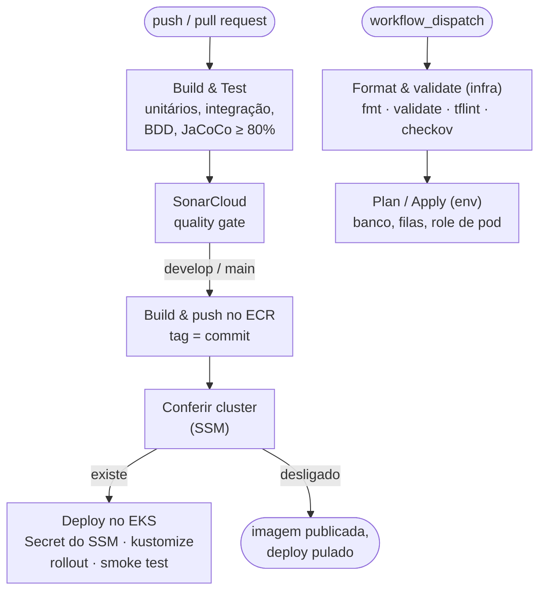

# Pipeline de CI/CD de cada serviço

Mesmo desenho nos três repositórios de serviço. `Build & Test`, `SonarCloud` e `Format & validate (infra)` são checks obrigatórios do PR para `develop` e `main`.

| Ambiente | Branch | Aprovação |
|---|---|---|
| homologação (`staging`) | `develop` | automática |
| produção (`prod`) | `main` | revisor obrigatório no environment |
