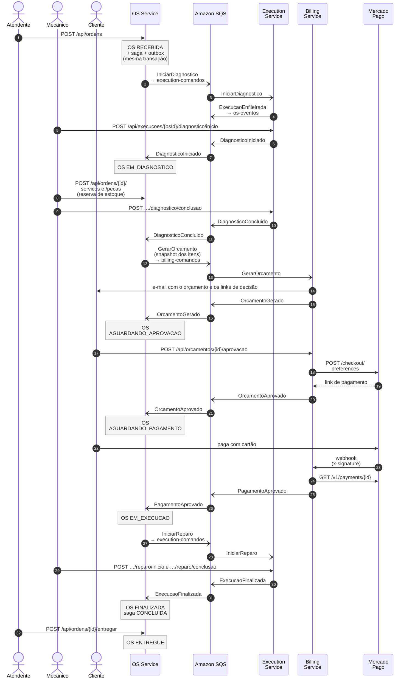

# Sequência — saga da OS, fluxo completo

Comandos do orquestrador seguem para a fila de cada participante; respostas e eventos voltam pela fila `os-eventos`. Toda mensagem sai pelo outbox do serviço emissor.

